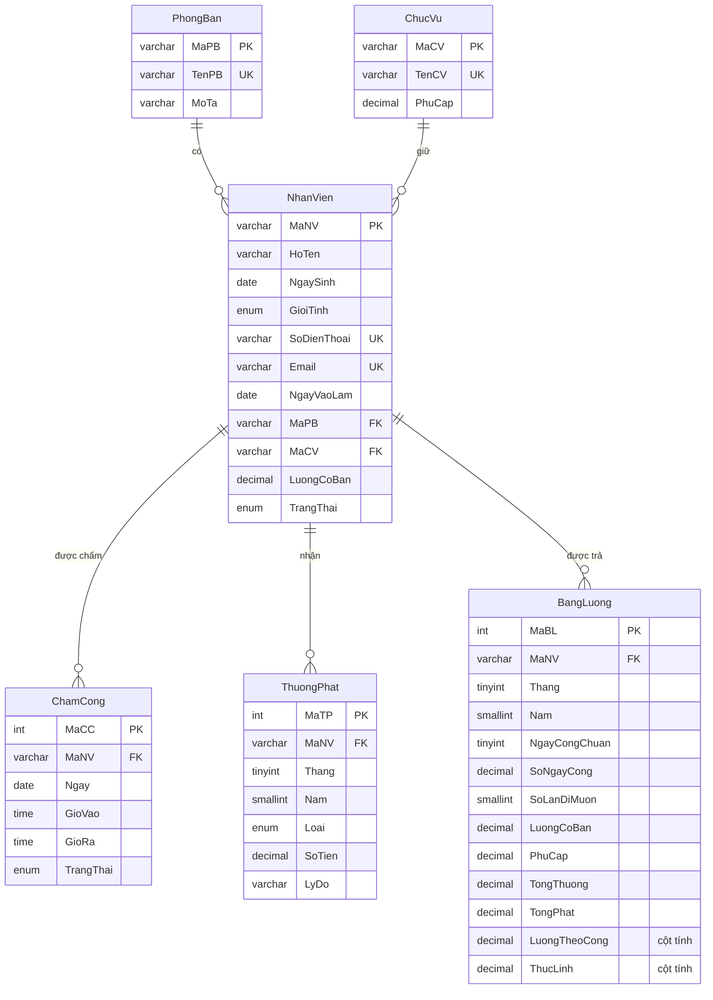

# Thiết kế CSDL – Đề tài 13: Quản lý lương nhân viên

CSDL: `quan_ly_luong` (MySQL 8.0, bảng mã `utf8mb4`).

## 1. Mô hình ERD



**Thực thể và quan hệ**

| Quan hệ | Bản số | Ý nghĩa |
|---|---|---|
| PhongBan – NhanVien | 1 – N | Mỗi nhân viên thuộc đúng 1 phòng ban |
| ChucVu – NhanVien | 1 – N | Mỗi nhân viên giữ đúng 1 chức vụ (quy định phụ cấp) |
| NhanVien – ChamCong | 1 – N | Mỗi ngày làm việc có tối đa 1 bản ghi chấm công/nhân viên |
| NhanVien – ThuongPhat | 1 – N | Một nhân viên có nhiều khoản thưởng/phạt trong tháng |
| NhanVien – BangLuong | 1 – N | Mỗi tháng có đúng 1 phiếu lương/nhân viên |

## 2. Lược đồ quan hệ

(Gạch chân = khóa chính, `#` = khóa ngoại)

- **PhongBan**(<u>MaPB</u>, TenPB, MoTa)
- **ChucVu**(<u>MaCV</u>, TenCV, PhuCap)
- **NhanVien**(<u>MaNV</u>, HoTen, NgaySinh, GioiTinh, SoDienThoai, Email, NgayVaoLam, #MaPB, #MaCV, LuongCoBan, TrangThai)
- **ChamCong**(<u>MaCC</u>, #MaNV, Ngay, GioVao, GioRa, TrangThai) — UNIQUE(MaNV, Ngay)
- **ThuongPhat**(<u>MaTP</u>, #MaNV, Thang, Nam, Loai, SoTien, LyDo, NgayTao)
- **BangLuong**(<u>MaBL</u>, #MaNV, Thang, Nam, NgayCongChuan, SoNgayCong, SoLanDiMuon, LuongCoBan, PhuCap, TongThuong, TongPhat, LuongTheoCong*, ThucLinh*, NgayTinh) — UNIQUE(MaNV, Thang, Nam)

`*` là cột sinh tự động (generated column), không nhập tay.

**Ràng buộc toàn vẹn**

- Khóa ngoại: `NhanVien.MaPB → PhongBan`, `NhanVien.MaCV → ChucVu` (ON UPDATE CASCADE, không cho xóa phòng ban/chức vụ còn nhân viên); `ChamCong`, `ThuongPhat`, `BangLuong` → `NhanVien` (ON DELETE CASCADE).
- CHECK: `LuongCoBan > 0`, `PhuCap >= 0`, `SoTien > 0`, `Thang BETWEEN 1 AND 12`, `GioRa > GioVao`.
- UNIQUE: email, số điện thoại, tên phòng ban/chức vụ; một nhân viên chỉ được chấm công 1 lần/ngày và có 1 phiếu lương/tháng.
- Miền giá trị (ENUM): `GioiTinh ∈ {Nam, Nu}`, `TrangThai NV ∈ {DangLam, DaNghi}`, `TrangThai chấm công ∈ {DiLam, DiMuon, NghiPhep, NghiKhongPhep}`, `Loai ∈ {Thuong, Phat}`.

## 3. Chuẩn hóa

**1NF** – Mọi thuộc tính đều nguyên tố: họ tên, giờ vào, giờ ra… mỗi ô một giá trị; không có nhóm lặp (các ngày chấm công được tách thành từng dòng trong `ChamCong` thay vì 31 cột ngày trong một dòng).

**2NF** – Các bảng dùng khóa chính một thuộc tính (`MaNV`, `MaCC`, `MaTP`, `MaBL`…), nên không thể có phụ thuộc bộ phận. Với khóa ứng viên ghép `(MaNV, Ngay)` của `ChamCong`: GioVao, GioRa, TrangThai phụ thuộc vào cả cặp (một nhân viên vào một ngày cụ thể), không chỉ vào `MaNV` hay `Ngay`.

**3NF** – Loại bỏ phụ thuộc bắc cầu:

- Nếu để `TenPB` trong `NhanVien` thì có `MaNV → MaPB → TenPB` (bắc cầu) → tách thành bảng `PhongBan`.
- Phụ cấp do chức vụ quy định: `MaNV → MaCV → PhuCap` → tách `ChucVu`, `NhanVien` chỉ giữ `MaCV`.
- `LuongCoBan` để ở `NhanVien` vì đó là mức lương theo hợp đồng của từng người (hai người cùng chức vụ có thể khác lương), nên phụ thuộc trực tiếp vào `MaNV`.

**Ghi chú về `BangLuong`**: các cột `LuongCoBan`, `PhuCap` được **chụp lại (snapshot)** tại thời điểm tính lương để giữ đúng lịch sử – khi nhân viên tăng lương hay đổi chức vụ thì phiếu lương các tháng cũ không bị thay đổi. Chúng phụ thuộc vào khóa `(MaNV, Thang, Nam)` chứ không phải vào `NhanVien` hiện tại, nên không vi phạm 3NF. Các giá trị suy diễn (`LuongTheoCong`, `ThucLinh`) dùng **generated column** nên MySQL luôn tự tính, không thể nhập sai.

## 4. Quy tắc tính lương

```
LuongTheoCong = LuongCoBan / NgayCongChuan × SoNgayCong
ThucLinh      = LuongTheoCong + PhuCap + TongThuong − TongPhat
```

- `NgayCongChuan` = số ngày từ thứ Hai đến thứ Bảy trong tháng (thủ tục tự đếm; ví dụ tháng 9/2026 = 26, tháng 10/2026 = 27).
- `SoNgayCong` = số ngày `DiLam` + `DiMuon` + `NghiPhep` (nghỉ có phép vẫn được tính công); `NghiKhongPhep` không tính công.
- `TongPhat` = tổng khoản phạt trong `ThuongPhat` + **50.000đ × số lần đi muộn**.
- Thủ tục `sp_TinhLuong(thang, nam)` tính lương cho toàn bộ nhân viên đang làm; chạy lại sẽ cập nhật phiếu lương cũ.
